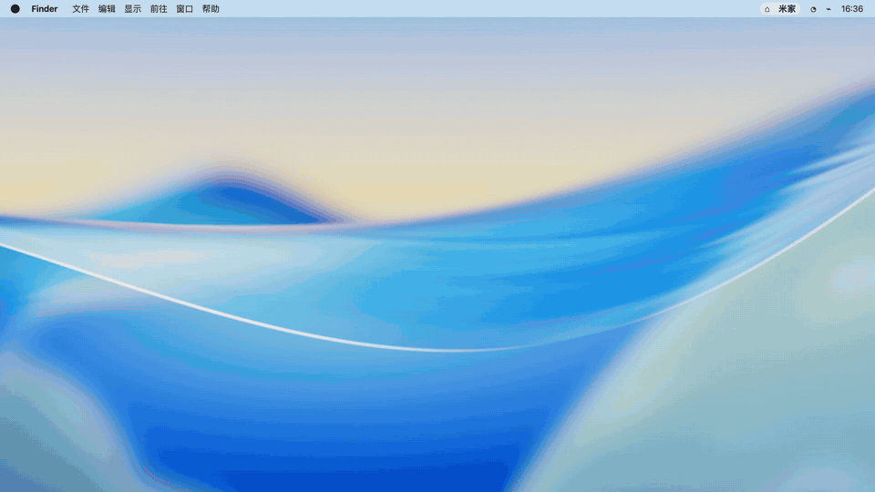
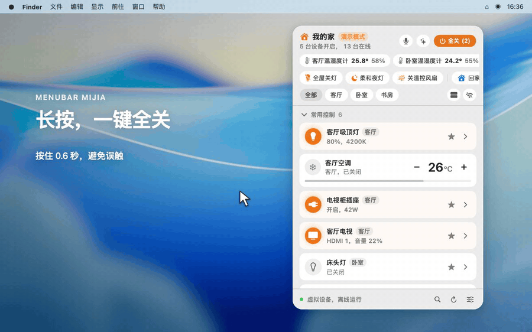
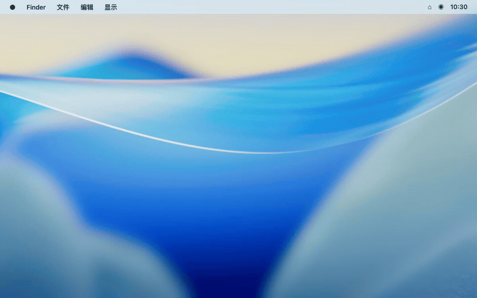
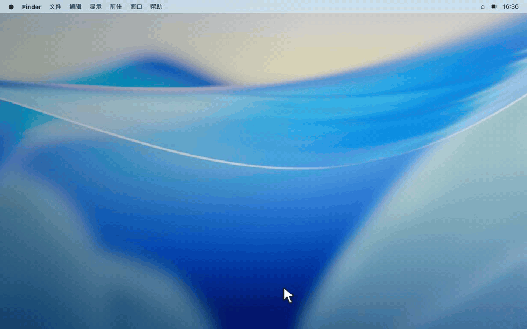

English | [简体中文](README.zh-CN.md)

<p align="center">
  <picture>
    <source media="(prefers-color-scheme: dark)" srcset="docs/assets/logo-dark.svg">
    <source media="(prefers-color-scheme: light)" srcset="docs/assets/logo-light.svg">
    
  </picture>
</p>

<h1 align="center">MenuBarMijia</h1>

<p align="center">
  <b>Control your entire home right from your computer, without picking up your phone.</b><br>
  A native macOS menu-bar app for Xiaomi / Mijia smart home devices, with a companion Windows 11 tray build.<br>
  Scan a QR code to connect directly to Mi Home without setting up Home Assistant. Features keyboard fuzzy search, push-to-talk voice, Mac event automation, and one-click undo.
</p>

<p align="center">
  <a href="https://github.com/jryang1997/MenuBarMijia/releases/latest"></a>
  
  
  
  
</p>

<p align="center">
  <a href="https://jryang1997.github.io/menubarmijia-web/">Official website</a> ·
  <a href="https://github.com/jryang1997/MenuBarMijia/releases/latest">Download latest</a> ·
  <a href="#quick-start">Install & Connect</a> ·
  <a href="#features--platform-matrix">Platform Comparison</a> ·
  <a href="#safety-privacy--limitations">Safety & Privacy</a> ·
  <a href="CHANGELOG.md">Changelog</a>
</p>

```bash
# Recommended one-line installation on macOS via Homebrew Cask
brew install --cask jryang1997/tap/menubarmijia
```

---

<p align="center">
  
</p>

<sub>macOS demo mode with simulated devices.</sub>

---

## Why Put Smart Home Control on Your Desktop?

When coding, writing, or in a meeting, you don't need to reach for your phone:

1. **Keep Your Hands on the Keyboard:** Press `⌥M` to summon the panel, type a name or pinyin initials (e.g. `sftd` for "Study Desk Lamp"), and hit `Return` to toggle. Open a device’s details and use the arrow keys to adjust brightness or AC temperature. No scrolling through nested room trees.
2. **Push-to-Talk, Release to Run:** Hold `⌥M` or the menu bar icon to speak your command, and release when you are done. Everyday commands like switching lights or setting the thermostat are interpreted by local parsing rules—no wake words, no sluggish voice chatter. Optional AI backends handle multi-step requests.
3. **Sync with Your Daily Work Rhythm:** Automatically turn off lights when you lock your Mac or step away. Trigger your focus lighting when plugging in an external display. All automation rules are disabled by default; you stay in full control of what triggers when.
4. **All Off, with Undo:** Hold "All Off" when it is time to call it a day. Plugs and robot vacuums stay on by default, and if you change your mind, the undo button brings your devices back.

---

## Feature Demos

Here are a few everyday actions in the macOS demo home. The interface shown is in Chinese.

### 1. Push-to-Talk Voice Control

No wake words needed. Hold the menu bar icon or global shortcut to speak, and see execution receipts right away (showing local millisecond execution or AI resolution).

<p align="center">
  
</p>

### 2. Room All-Off with Safety Protection & Undo

Heading out or turning in? Hold "All Off" for 0.6 seconds to switch off participating devices in the current view. Plugs, robot vacuums, and cameras are left alone by default, and you can change that in settings. If you switch something off by mistake, tap Undo.

<p align="center">
  
</p>

### 3. macOS Display & Lock-Screen Automation

Turn everyday desktop transitions into ambient triggers. Configure a rule to turn off lights when you lock your screen or put your Mac to sleep. You can also configure a separate rule for returning.

<p align="center">
  
</p>

### 4. Climate Trends & Energy Metrics

Wondering whether the room is warmer than yesterday? On macOS, open a sensor to see its temperature and humidity trends over 24 hours or 7 days. For plugs that report energy readings, device details show today’s usage and settings show the last 7 days.

<p align="center">
  
</p>

---

## Features & Platform Matrix

The macOS version is built natively in Swift 6, while the Windows 11 client is an independent implementation using Tauri v2 and TypeScript. Both share verified golden fixtures (`Tests/Fixtures/`) for protocol and intent matching, while respecting system platform differences.

| Feature Area | macOS Native (14+) | Windows 11 Tray | Details |
| :--- | :---: | :---: | :--- |
| **Mi Home Direct QR Connect** | ✅ Supported | ✅ Supported | Scan with Mi Home app; supports CN, SG, DE, US, and RU regional servers |
| **Home Assistant Integration** | ✅ Supported | — Not yet | macOS connects via local WebSocket and synthesizes official `xiaomi_home` entities |
| **Keyboard Search & Control** | ✅ Supported | — Not yet | On macOS, search by device name or pinyin initials and use arrow keys to control devices |
| **Global Activation Hotkey** | ✅ `⌥M` (Customizable) | ✅ `Alt+M` (Customizable) | Windows 1.1.4 adds custom key recording with collision detection |
| **Voice Interaction** | ✅ Menu bar hold / Hotkey hold / Hands-free | ⚠️ Hands-free only | macOS supports native Speech frameworks; Windows uses WebView speech recognition |
| **Local Command Parsing** | ✅ Supported | ✅ Supported | Power, brightness, temp, fan speeds, and timers are parsed locally |
| **Optional AI Assistant** | ✅ Supported | ✅ Supported | Connect Jev, DeepSeek, Ollama, etc. Actions with <80% confidence require confirmation |
| **All-Off & Instant Undo** | ✅ Supported | ✅ Supported | A 0.6s hold confirms the action; plugs and vacuums are excluded by default; reversible actions show an undo banner for 10–15s |
| **Mac Event Automation** | ✅ Supported | — Not yet | Event triggers on screen lock, sleep, wake, and external display connections |
| **Apple Shortcuts (App Intents)** | ✅ Supported (4 actions) | — Not yet | Toggle Device, Run Scene, Voice Command, Query Room Climate |
| **URL Scheme Control** | ✅ Supported | — Not yet | `menumijia://toggle` calls require confirmation by default; direct control can be enabled in settings |
| **Sensor Trend Line Charts** | ✅ 24h / 7d trends | ⚠️ Real-time value only | macOS charts temperature or humidity over selectable periods; Windows shows current readings |
| **Smart Plug Energy Logs** | ✅ Supported | — No history yet | macOS counts changes in cumulative hardware readings; missing data is not estimated |
| **Mi Air Purifiers** | ✅ Supported | ✅ Supported | Both platforms synthesize `air-purifier` specs: PM2.5, air quality, temp/humidity, filter life, and a 1–100% fan slider driving the favorite level |
| **Camera Live View** | ✅ Supported | ✅ Supported | Click a card for a pinned live window: macOS uses HLS / HA snapshots; Windows ships a private P2P bridge (substream MJPEG) |
| **Visual Look** | ✅ One system look + 4 heights | ✅ Control Center design | macOS keeps system materials only: devices that are on sit on a bright platter, everything else is glass. |
| **Code Signing & Integrity** | ⚠️ Self-signed + Ed25519 updates | ⚠️ Unsigned package | macOS requires manual Gatekeeper approval; Windows shows SmartScreen prompt |

---

## Quick Start

### 1. Requirements & Installation

- **macOS:** macOS 14 (Sonoma) or later.
- **Windows:** Windows 11 (64-bit).

#### Installing on macOS

**Method A: Homebrew Cask (Recommended)**
```bash
brew install --cask jryang1997/tap/menubarmijia
```
> If Homebrew asks to trust a new third-party tap, run `brew trust --cask jryang1997/tap/menubarmijia` first.

**Method B: Direct DMG Download**
Download the latest macOS DMG from [GitHub Releases](https://github.com/jryang1997/MenuBarMijia/releases/latest) and drag `MenuBarMijia.app` into your Applications folder.
> **About macOS Gatekeeper:**<br>
> This project is an independent open-source tool and is not enrolled in the paid Apple Developer Program (no Developer ID notarization). If Gatekeeper blocks initial launch, open **System Settings → Privacy & Security**, scroll down, and click **"Open Anyway"** for MenuBarMijia.

#### Installing on Windows 11

Download the latest Windows x64 `.exe` or `.msi` from [GitHub Releases](https://github.com/jryang1997/MenuBarMijia/releases/latest).
> **About Windows SmartScreen:**<br>
> The Windows binary is not signed with an enterprise Authenticode certificate. If SmartScreen shows "Windows protected your PC", click **"More info" → "Run anyway"**. SHA-256 digests are published on each Release for manual verification.

---

### 2. Connect Your Devices

Click the menu bar icon to reveal the panel, then open Settings `⚙️`:


- **Option A: Mi Home Direct Cloud Connect (Recommended):**<br>
  Select "Mi Cloud Connect" in Settings. A QR code appears on screen. Scan it with the official Mi Home app on your phone to link your account. All your homes, rooms, and supported devices sync instantly.
- **Option B: Home Assistant Local Connection (macOS Only):**<br>
  Select "Home Assistant" and enter your local instance URL (e.g. `http://192.168.1.100:8123`) and Long-Lived Access Token. The synthesizer groups supported sensor and switch entities into device cards.
- **Option C: Offline Demo Home:**<br>
  Explore the interface and controls without an account using simulated devices.

---

## Keyboard Shortcuts & Natural Commands

### Keyboard Navigation

These panel shortcuts apply to macOS. On Windows, the default shortcut to open the panel is `Alt+M`.

| Shortcut | Action |
| :--- | :--- |
| `⌥M` | Toggle the MenuBarMijia panel |
| Type letters | Instant search by device name, room, or pinyin initials (e.g. `sftd`) |
| `↑` / `↓` | Navigate through search matches and device cards |
| `Return` / `Space` | Toggle the focused device; expand the detail drawer if not directly switchable |
| `→` / `←` | Press Right to open details; then use Left and Right to adjust light brightness, AC temperature, or volume |
| `Tab` | Switch between room tabs |
| `Esc` | Clear search query, close drawer, or dismiss panel |

### Local Natural Language Commands

These phrases are parsed locally **without any AI API key** or cloud model tokens:

- **Power:** "turn off study light", "turn on living room ac", "turn off all lights"
- **Lighting presets:** "study light moonlight mode", "daylight mode"
- **Adjustments:** "dimmer", "brighter", "set bedroom light to 40%"
- **Climate & Fan:** "set ac to 24 degrees", "warmer", "fan natural wind"
- **Timers:** "in 10 minutes turn off study light", "cancel timer"
- **Undo:** "undo", "revert" (active for 10 minutes after any batch execution)

---

## Safety, Privacy & Limitations

MenuBarMijia is an independent open-source project, not an official Xiaomi app. Mi Home cloud control needs an internet connection. If you already use Home Assistant, you can connect your own instance on macOS.

Account credentials and AI keys are stored in the macOS Keychain or Windows Credential Manager. macOS may ask for Keychain permission after an update. When migrating credentials from an older version, the plaintext copy is removed after the Keychain accepts it.

Everyday commands are handled by local rules. You can also connect an AI service of your choice for more complex requests. The request includes your command, device and environment information, and any habit summary you have enabled. Speech recognition uses system services; on-device-only recognition is available for supported languages.

To help prevent mistakes, low-confidence AI suggestions and actions such as turning on a heater, switching a plug, or starting a vacuum wait for your confirmation. URL controls also ask first by default, with an option to enable direct control.

The macOS app is not yet notarized by Apple, so you may need to allow it in System Settings the first time. Windows may show a SmartScreen prompt. macOS updates are verified with an Ed25519 public key; the signing key stays offline. See [ADR-0007](docs/adr/0007-lan-direct-deferred.md) for more on connection options.

---

## Development & Architecture

- **Architecture:** The macOS version is written in pure Swift 6 with **no third-party Swift runtime dependencies**, adhering to strict concurrency rules. Core protocol handling and device synthesis live in `MijiaCore` with full headless test coverage. The Windows client is built with Tauri v2 (Rust + TypeScript + Vite).
- **Cross-Platform Consistency:** Both platforms run separate test suites against shared golden test fixtures in `Tests/Fixtures/` (intents, specs, regions, AI payloads) to prevent behavioral drift (see [ADR-0006](docs/adr/0006-dual-platform-implementation.md)).

### Local Build & Verification

```bash
# Run secret checks, linters, and Swift tests on macOS
bash scripts/check.sh

# Build, sign locally, and launch MenuBarMijia.app
bash scripts/build_app.sh

# Build and test the Windows tray app
cd windows
npm install
npm test
npm run build
```

Please review [CODING_STANDARDS.md](CODING_STANDARDS.md) before submitting pull requests. Key domain concepts are documented in [GLOSSARY.md](GLOSSARY.md).

---

## Contributors

Thanks to everyone who has contributed features, fixes, and feedback:

- [@jryang1997](https://github.com/jryang1997) (一群小羊说) — Creator & maintainer
- [@almightyYantao](https://github.com/almightyYantao) (Alimighty.Yantao) — Multi-key Mesh switch split-device synthesis ([#6](https://github.com/jryang1997/MenuBarMijia/issues/6), [#7](https://github.com/jryang1997/MenuBarMijia/pull/7)), multi-home switcher & light-group scene filtering ([#8](https://github.com/jryang1997/MenuBarMijia/pull/8)), visual skin system, inline climate module, drag-to-reorder layout & custom device groups ([#9](https://github.com/jryang1997/MenuBarMijia/pull/9)), macOS app bundle icon packaging ([#10](https://github.com/jryang1997/MenuBarMijia/pull/10)), panel drop-in animation, local device renaming & room-strip polish ([#11](https://github.com/jryang1997/MenuBarMijia/pull/11)), Windows feature parity and cross-platform UI fixes ([#12](https://github.com/jryang1997/MenuBarMijia/pull/12)), and redundant-write optimization for provider snapshots ([#66](https://github.com/jryang1997/MenuBarMijia/pull/66))

## License & Acknowledgements

- **License:** Distributed under the [MIT License](LICENSE).
- **Third-Party Integrations:** This repository does not distribute third-party integrations. The optional Home Assistant scripts reference repositories: [xiaomi_home](https://github.com/XiaoMi/ha_xiaomi_home) and [midea_ac_lan](https://github.com/wuwentao/midea_ac_lan).
- **Trademarks:** "Xiaomi", "Mijia", and "Midea" are registered trademarks of their respective owners. Used here solely to indicate device compatibility.

Thanks to all contributors who have submitted PRs, reported issues, and helped refine the desktop smart home experience! If MenuBarMijia helps you keep your hands on the keyboard, please give it a ⭐ Star on GitHub.
