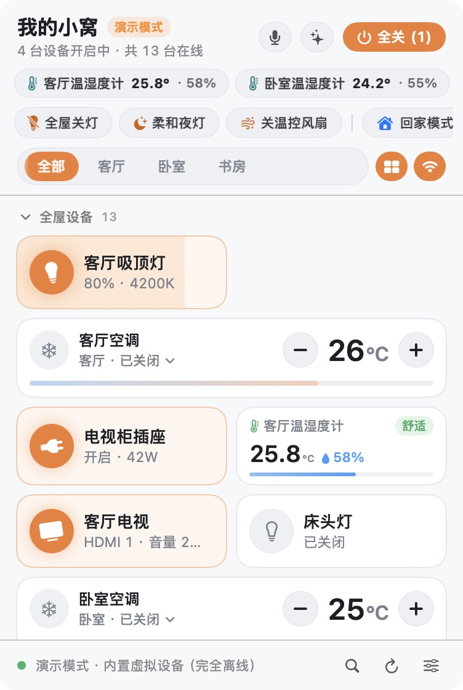
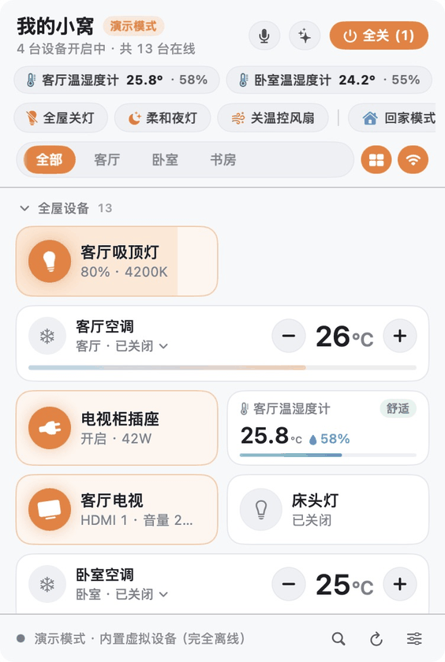
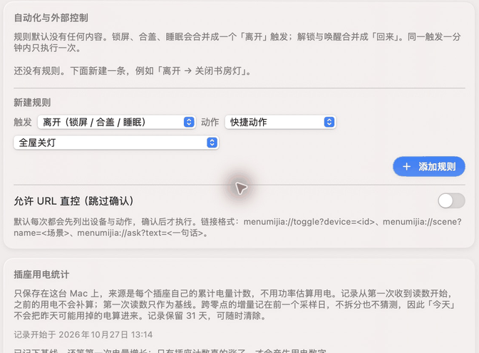
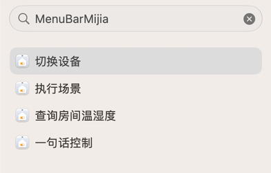

<p align="center">
  <picture>
    <source media="(prefers-color-scheme: dark)" srcset="docs/assets/logo-dark.svg">
    <source media="(prefers-color-scheme: light)" srcset="docs/assets/logo-light.svg">
    
  </picture>
</p>

<h1 align="center">MenuBarMijia</h1>

<p align="center">
  <b>Native macOS menu-bar controller for Xiaomi Mi Home (Mijia) and Home Assistant, plus a Windows 11 tray app for Mi Home.</b><br>
  Hold the menu-bar icon, speak a command, release to execute across multiple devices, or run the entire panel from the keyboard.
</p>

<p align="center">
  <strong>English</strong> · <a href="README.zh-CN.md">简体中文</a>
</p>

<p align="center">
  <a href="https://github.com/jryang1997/MenuBarMijia/releases/latest"></a>
  
  
  
  
  <a href="LICENSE"></a>
</p>

<p align="center">
  <a href="https://github.com/jryang1997/MenuBarMijia/releases/tag/v1.1.1">Download v1.1.1</a> ·
  <a href="#install">Install and connect</a> ·
  <a href="CHANGELOG.md">Changelog</a>
</p>

```bash
brew install --cask jryang1997/tap/menubarmijia
```

<p align="center">
  
</p>

Control your home while you work on your Mac. Press `⌥M`, type a device name or its Pinyin initials, and press Return to toggle it. Hold the menu-bar icon to speak and release to send a command across devices. Scan a QR code with Mi Home to connect, or use your existing Home Assistant installation.

> New screenshots and GIFs are captured from the running macOS app using its offline demo home. Devices and readings are simulated. They show real UI interactions, not hardware response times. Features below apply to macOS unless Windows is named explicitly.

This is a personal open-source project, not affiliated with, authorized by, or endorsed by Xiaomi, Mi Home, or Midea. Their trademarks are used only to identify compatible products.

## Why keep home controls in the menu bar

| When you want to… | What the app does |
| --- | --- |
| Find a device without browsing rooms | Search names, rooms, or Pinyin initials. Use arrows to select, Return to toggle, and the right arrow to open controls. |
| Change several devices in one sentence | Speak without a wake word or spoken reply. Clear commands use a local parser; optional AI handles more complex requests. |
| Select a light's actual moonlight mode | Read native device modes and expose supported brightness, color temperature, and scene controls. |
| Make a large HA setup readable | Combine related entities into one physical device card with controls for that device type. |
| Recover from a batch change | Undo restores the properties changed, including brightness, light mode, and climate settings. Uncertain AI actions wait for a tap. |
| Turn off study lights when leaving the Mac | Create an Away rule or combine the app's actions with other apps in macOS Shortcuts. No automation rules are enabled by default. |
| Arrange controls your way | Choose nine skins, four heights, custom groups, card sizes, drag ordering, and inline climate controls. |

## What's new in 1.1.1 & 1.1.0

- **1.1.1 highlights**: Single-item Keychain vault (`CredentialVault`) so macOS updates prompt once with a clear explanation; property-scoped undo isolated per home; offline plugs skipped when recording energy; clicking outside dismisses the panel; notification status refreshes when returning from System Settings; and Homebrew tap auto-sync (`brew install --cask jryang1997/tap/menubarmijia`).
- Search by name, room, or Pinyin initials, with keyboard selection and control.
- Four macOS Shortcuts actions: toggle a device, run a scene, control with a sentence, and query room temperature and humidity. URL commands ask for confirmation by default.
- Mac automation triggers for Away, Back, and external display connection or disconnection. Repeated events are deduplicated for one minute; actions support undo.
- Local plug energy history with daily and seven-day totals, device rankings, and an optional electricity price. Figures use measured cumulative counters, never estimates from wattage.
- Hold All Off for 0.6 seconds. It affects the current room's visible devices, excluding plugs and vacuums by default. Timers missed by more than a minute need confirmation.
- Keychain credential migration, explicit AI key import and cloud consent, and independent Ed25519 verification for update packages.
- Less frequent Mi Cloud polling when the panel is closed, paused during sleep or lock, and fewer redundant UI updates.
- Traditional Chinese resources and Celsius or Fahrenheit display. Some Traditional Chinese strings still fall back.

### Search, control, and undo

<p align="center">
  
</p>

The GIF uses successive screenshots of actual operations: search, toggle, run “关闭所有灯” (turn off all lights), and undo. [View the static search screenshot](docs/assets/v1.1.0/search.png).

Type directly in the panel or press `⌘F`. In the demo home, `sftd` matches 书房台灯, the study lamp. The global hotkey defaults to `⌥M` and can be changed in Settings.

### Connect Mac events to your home

<p align="center">
  
</p>

[View the static settings screenshot](docs/assets/v1.1.0/automation.png). The GIF uses successive UI screenshots. It stops before adding the rule, so no temporary automation is saved.

Open **Settings → General → Automation & External Control** to choose a trigger and an action. Lock, lid close, and sleep share the Away trigger. Unlock and wake share Back. Rules run while the app is running; lock notifications and network delivery just before sleep depend on system state.

<p align="center">
  
</p>

In macOS Shortcuts, search for MenuBarMijia to use the four actions. External tools can open `menumijia://toggle?device=<id>`, `menumijia://scene?name=<scene>`, or `menumijia://ask?text=<command>`. URL-encode parameter values. The app asks before executing unless you explicitly enable direct control.

Energy history starts with the first reported cumulative reading and keeps 31 days locally. Earlier usage is not backfilled. A missing reading is not zero consumption. These features, Pinyin search, and Mac event automation do not imply Windows feature parity.

## Requirements

- macOS 14 (Sonoma) or later (`Package.swift` sets `.macOS(.v14)`; macOS 26 renders native SwiftUI `.glassEffect` Liquid Glass, while macOS 14 and 15 fall back to `.ultraThinMaterial`; `MijiaCore` also builds on Linux with Swift 6.1)
- Swift 6 toolchain to build

The Swift package has no third-party Swift dependencies and uses Swift 6 strict concurrency.

## Install

### Homebrew (macOS)

```bash
brew install --cask jryang1997/tap/menubarmijia
```

On Homebrew 7+, if prompted to trust the third-party tap on first install, run `brew trust --cask jryang1997/tap/menubarmijia` first. The cask installs the same release DMG verified by SHA-256 and does not bypass Gatekeeper quarantine.

### GitHub Releases

Releases: <https://github.com/jryang1997/MenuBarMijia/releases>

[v1.1.1](https://github.com/jryang1997/MenuBarMijia/releases/tag/v1.1.1) packages are `MenuBarMijia-1.1.1.dmg` for macOS 14+ on Apple Silicon, and `MenuBarMijia-1.1.1-windows-x64-setup.exe` / `.msi` for Windows x64. Download the published packages from [Releases](https://github.com/jryang1997/MenuBarMijia/releases/latest); each installer has a SHA-256 file and the DMG also has an Ed25519 update signature.

The macOS release uses a fixed self-signed certificate and is not Apple-notarized. On first launch, macOS may block it. The safer fix is **System Settings → Privacy & Security → Open Anyway**, which clears the block for this one app only. Running `xattr -cr /Applications/MenuBarMijia.app` also works, but it strips every extended attribute from the bundle and skips the quarantine check entirely, so use it only if you downloaded the file from this repository's Releases page. The command will be removed once Apple signing and notarization are in place.

**v1.0.0** macOS assets were named `MenuMijia-1.0.0.dmg`.

After install, enable **Launch at login** in Settings if you want the menu-bar icon at startup. **Check for updates** in Settings reads GitHub Releases.

### Build from source

```bash
git clone https://github.com/jryang1997/MenuBarMijia.git
cd MenuBarMijia
bash scripts/build_app.sh
```

The script builds a Release binary, writes microphone and speech-recognition usage strings into `MenuBarMijia.app`, signs it locally, and launches it. Drag `MenuBarMijia.app` to `/Applications` if you want it there.

<details>
<summary>Maintainers: packaging, signing, and release verification</summary>

A Developer ID build, DMG, and Apple notarization are optional and need an Apple Developer account:

```bash
DEVELOPER_ID="Developer ID Application: Your Name (TEAMID)" \
bash scripts/release.sh
```

Store notary credentials first with `xcrun notarytool store-credentials menumijia-notary`. `SKIP_NOTARIZE=1` packs a local DMG without notarization. The version string is the `VERSION` file. The build number is the git commit count.

In-app updates additionally require a detached Ed25519 signature, and release publishing is split in two phases so the private key never reaches CI.

**Phase 1 — tag build (CI).** Pushing a `v*` tag (or running `.github/workflows/release.yml` manually with a `tag` input) runs `verify-tag` → `macos-release` / `windows-release` → `stage-draft`. The two build jobs only upload artifacts; `stage-draft` creates or refreshes an **unpublished draft** holding exactly six build assets (DMG, `.dmg.sha256`, EXE, `.exe.sha256`, MSI, `.msi.sha256`) and finishes with “⏳ waiting for the offline signature”. `release.yml` never contains `--draft=false`, so a tag push can never publish.

**Phase 2 — offline signature (maintainer's machine).** Download the draft DMG, sign it with the offline key, and upload only the public signature:

```bash
gh release download <tag> --pattern "MenuBarMijia-<version>.dmg" --dir dist
MENUBARMIJIA_UPDATE_SIGNING_KEY="<base64 32-byte seed or PKCS#8 PEM>" \
  swift scripts/sign_update.swift dist/MenuBarMijia-<version>.dmg
gh release upload <tag> "dist/MenuBarMijia-<version>.dmg.ed25519.sig"
```

**Phase 3 — Finalize (CI, manual).** Run `.github/workflows/finalize.yml` (`workflow_dispatch`, input `tag`). It requires the tag to equal `v$(VERSION)`, all four version files to agree, the remote tag to still point at the checked-out commit, and the target to be an unpublished draft. It downloads **exactly seven** assets, compares each download's bytes against the draft's server-side `sha256:` digest and size, and verifies the DMG signature with the public key compiled into `UpdateChecker.updateSigningPublicKeyBase64` (there is no configurable public key; rotating it requires a source change and a new release). Only then does it run `gh release edit --draft=false`: no rebuild, no upload, no `--clobber`. A missing `.sig` prints the offline commands and exits non-zero; a signature that no longer matches rebuilt bytes fails hard, so a release can never quietly ship without a valid signature.

Neither `release.yml` nor `finalize.yml` reads `MENUBARMIJIA_UPDATE_SIGNING_KEY`, so **CI holds no Ed25519 update key** — only the code-signing credentials (`MACOS_SIGNING_P12` for macOS, `WINDOWS_CERTIFICATE` for Authenticode).

The app refuses to install a package whose Ed25519 signature is missing or does not match. It then verifies the staged bundle's code signature with the requirement `identifier "<bundle id>" and certificate leaf = H"<pinned SHA-1>"`: the leaf certificate hash is the anchor, and the packaged `Info.plist` must carry `MijiaCodeSignCertSHA1`. If that pin is missing or is not a 40-character hex string, the requirement becomes `identifier "<bundle id>" and never`, so **every** update fails verification — including a package with the same bundle ID, so the check never falls back to bundle-ID-only.

A local ad-hoc build (`scripts/build_app.sh`) still launches normally, but it has no valid pin and therefore **cannot install in-app updates**. Release builds must be signed with a fixed certificate and carry that certificate's SHA-1: `scripts/release.sh` refuses to produce a DMG without a non-ad-hoc signing identity and a matching pin. See [`docs/adr/0005-update-signing-trust-chain.md`](docs/adr/0005-update-signing-trust-chain.md).

</details>

## Connect devices

Open the menu-bar icon, then the settings button.

**Mi Cloud (no Home Assistant).** Choose **Mi Cloud direct**, then **Scan to sign in to Mi Home**, and confirm the QR code in the phone Mi Home app. Homes, rooms, and devices sync from your account. The client speaks Miot-Spec over Xiaomi’s `api.io.mi.com` private API. RC4 there is the **transport** cipher and signing scheme of that endpoint (`MIOT-ENCRYPT-ALGORITHM: ENCRYPT-RC4`), not end-to-end encryption: commands and states pass through Xiaomi’s servers, which can read them, and RC4 itself is a deprecated weak cipher kept only for compatibility. `serviceToken` and `ssecurity` are stored in the macOS Keychain. Note: `api.io.mi.com` is an undocumented private client API, and Xiaomi has restricted accounts that use unofficial clients in the past. Use the Home Assistant backend below if you want Xiaomi's official open-source `xiaomi_home` integration.

**Home Assistant (optional).** Choose **Home Assistant**, enter the base URL and a long-lived access token (created on your HA profile page). The default URL is `http://homeassistant.local:8123`. Use the LAN IP if that hostname does not resolve. The Mac app subscribes to `state_changed` over the LAN WebSocket. It works with [xiaomi_home](https://github.com/XiaoMi/ha_xiaomi_home) and [midea_ac_lan](https://github.com/wuwentao/midea_ac_lan). Separate HA entities (switch, power, energy, child lock, gateway light, and similar) are folded into one card per physical device.

An `http://` HA address outside this machine sends the access token unencrypted across the network. Settings and onboarding show an orange warning for exactly that case and suggest an `https://` or Nabu Casa address; the LAN default stays plain `http` for local setups.

<p align="center">
  
</p>

<p align="center">
  
</p>

If you already have a Synology NAS and want HA there, `bash nas/deploy_ha.sh` pulls images and preinstalls `xiaomi_home` and `midea_ac_lan` on that machine. The repo does not vendor those integrations.

## Control

Hold the menu-bar icon (the house and, when enabled, a temperature) and speak. Release to send. Releasing right after the panel opens (before any words are recognized), the **V** key, or the panel microphone button starts hands-free dictation instead. Speech submits after a 1.1 second pause. There is no wake word and no spoken reply.

`⌥M` toggles the panel. You can run the panel from the keyboard.

The menu bar can show a room temperature, temperature and humidity, total plug power, the count of devices that are on, or only the house icon.

| Key | Action |
| --- | --- |
| `⌥M` | Show or hide the panel (global) |
| Type / `⌘F` | Search device names, rooms, or Pinyin initials |
| `V` | Start or stop live voice control (submits after a 1.1s pause) |
| `/` | Open the command field and focus it |
| `1`–`9` | Toggle devices 1–9 (hold `⌥` to show the number badges) |
| `↑` `↓` | Move focus between devices |
| `Space` / `Return` | Toggle the focused device, or open its drawer if it has no simple switch |
| `→` `←` | Open the drawer, then step brightness ±10%, temperature ±1°C, or volume ±10% |
| `Tab` | Switch between All and each room |
| `Esc` | Close the voice or command bar, close the drawer, or close the panel |

Device drawers cover lights (brightness, 2700–6500 K color temperature, and the device’s own scene modes such as daylight, moonlight, reading, and computer), climate (0.5°C steps, mode, fan, swing), fans, plugs (watts, today’s kWh, child lock), fridges, robot vacuums, Xiaoai speakers (volume, mute, playback, TTS or a silent command), and TVs.

**All off** turns off lights, air conditioners, heaters, and fans that are on, for the devices currently on screen. Smart plugs and vacuums are **excluded by default** and can be added per device from the context menu (Windows 1.1.0 exposes that choice in Settings). Shortcuts also include whole-home lights off, a dim night-light scene, and climate plus fans off.

### Skins, custom groups, and multi-home switching

- **Multiple Mi Homes & split Mesh panels**: When your Xiaomi account has multiple homes, click the home title in the header to switch between them or view all homes together. Multi-key Mesh wall panels (split keys with IDs like `<parent>.s2`, `<parent>.s3`) are automatically unpacked into individual switch cards.
- **9 visual skins & adjustable height**: Switch between **Classic**, **Frost**, **Night Flight**, **Liquid Glass**, **Soft Mist**, **Bento**, **Neon**, **Capsule**, and **Dawn** in Settings, along with four panel height presets.
- **Drag-to-reorder & custom groups**: Long-press any device card (or right-click → **Edit Layout**) to drag cards across positions and sections, cycle card sizes (`½ Width`, `Full Width`, or `Panel` for inline climate controls), and organize devices into collapsible custom groups.

## Spoken commands

The local parser accepts Chinese and English commands without an AI request. Device control still needs the selected Mi Cloud or HA backend.

| Goal | Chinese example | English example |
| --- | --- | --- |
| On or off | 「关客厅灯」「把空调打开」 | `"turn on study light"`, `"turn off all lights"` |
| Light mode | 「书房吸顶灯月光模式」 | `"study light moonlight mode"`, `"daylight mode"` |
| Brightness nudge | 「再暗一点」「主卧灯亮一点」 | `"dimmer"`, `"brighter"`, `"study light 40%"` |
| Temperature | 「调高两度」「温度低一点」 | `"set living room ac to 24 degrees"`, `"warmer"` |
| Fan | 「风扇开高档」「风速调低」「摇头」「停止摇头」 | `"fan high speed"`, `"stop swing"` |
| Timer | 「10 分钟后关灯」「取消定时」 | `"in 10 minutes turn off study light"`, `"cancel timer"` |
| Undo | 「撤销」「刚才那个撤销」 (within 10 minutes) | `"undo"`, `"revert"` (within 10 minutes) |

A nudge that does not name a device applies only to devices that are already on. Timers persist to `UserDefaults` across app restarts. Future timers resume their countdown on launch. Timers that expired while the app was closed, or that came due while the Mac was asleep (more than a minute late), are not executed automatically; the app surfaces a missed-timer prompt and notification so you can run or dismiss them.

Phrases the local parser does not understand can be sent to an optional cloud or local AI model. Settings includes one-click presets for **OpenRouter (`~typesafe/jev-latest`)**, **Native TypeSafe Jev (`https://api.typesafe.ai/v1`)**, **DeepSeek (`deepseek-chat`)**, **Qwen**, **Zhipu GLM**, **Moonshot Kimi**, **SiliconFlow**, **OpenAI**, **Groq**, **Ollama (local)**, and custom OpenAI-compatible endpoints. Provide your own API key in Settings, or on macOS click **Import key from CodexBar / environment** (the CodexBar file and environment variables are only read when you click it). The first time a phrase would go to a cloud model, the app asks once and shows what will be sent. Without an API key, ambiguous commands fail while clear commands still run on the local parser. AI actions only run by themselves when the model is at least 80% sure; anything less shows up as a suggestion you tap to run. Turning on a heater, switching a smart plug, or starting a vacuum always waits for your tap.

The app also stores, on this Mac, time-of-day habits and short phrases you repeat (for example a phrase you use when you start working or go to sleep) and can attach a short habit summary to those cloud requests. Turn off **Learn my habits** in Settings to stop recording and stop sending that summary. You can delete stored habits one by one.

## Undo

A multi-device change raises an undo bar: **10 seconds for one or two devices, 15 seconds from three devices up**, and resting the pointer on the bar pauses the countdown. **All Off** needs a 0.6 s hold in every skin and only affects what is on screen (the selected room, no hidden devices); smart plugs and vacuums are left out unless you include them from the device menu (Windows 1.1.0 puts that control in Settings). Choosing **Undo** restores the previous state of the devices that changed device by device, including brightness, color temperature, light mode, and air-conditioner setpoint. Once the bar disappears, an **Undo** entry stays in the panel for the assistant’s last action, valid for 10 minutes.

Saying 「撤销」 within 10 minutes rolls back the assistant’s last action.

## Safety alerts

When safety alerts are on, macOS notifications fire for:

- A plug left on for 45 minutes **while reporting live power above 300 W**. A plug that reports no power reading never triggers this alert. The notification can turn it off.
- A climate device (air conditioner or heater) left running for 4 hours. The notification can turn it off.
- Battery under 15% on a sensor or lock. The same device is not notified again for 24 hours; the cooldown is stored, so relaunching the app does not reset it.
- A starred device going offline.

## Windows 11 tray app

`windows/` is a separate Tauri v2 tray app (Rust, TypeScript, WebView2). It is not the Mac app, and it is a **separate implementation** of the same ideas rather than a port of `MijiaCore`: the Mi Cloud protocol, device synthesis, local parsing, and AI request shape are written twice. ADR-0006 ([`docs/adr/0006-dual-platform-implementation.md`](docs/adr/0006-dual-platform-implementation.md)) records that decision and the shared fixtures (`Tests/Fixtures/intent_golden.json`, `miot_golden.json`, `provider_golden.json`, `region_golden.json`, `ai_request_golden.json`) that both test suites assert against.

Starting with 1.1.0 it supports Mi Cloud QR login (including a region picker) and a demo mode. It does **not** connect to Home Assistant. It has no menu-bar press-and-hold speech and no safety alerts. Speech uses the WebView `SpeechRecognition` API. The global hotkey is `Alt+M`.

Device cards update after the cloud call succeeds. A failure shows an error. A batch reports partial failure. Undo restores only properties that succeeded, and it keeps the original on/off state. A failed undo can be retried. If the original property value is missing or the action cannot be reversed, there is no undo button. Light mode buttons appear only when the device supports them.

Windows 1.1.0 includes the region picker (#37), update checks (#39), Credential Manager storage and strict CSP (#28), and safer All Off defaults (#23). Windows installers are Authenticode-signed only when the release workflow has a signing certificate configured; 1.1.0 ships unsigned and SmartScreen may warn on first launch. Region selection is covered by shared fixtures; an actual overseas account has not been verified.

```bash
cd windows
npm install
npm test
npm run build
npx tauri build   # on Windows: NSIS .exe and .msi
```

Packaging needs Visual Studio “Desktop development with C++”, the Windows SDK, and the MSVC Rust toolchain. Build from an x64 Native Tools prompt. If `CC` or `CXX` points at another compiler, set them to `cl.exe` in that prompt.

Pushes to `main` run core tests, then GitHub Actions builds the Windows installers and uploads them as the `MenuBarMijia-Windows-x64` artifact; pushes never publish. A `v*` tag only produces a **draft** with six build assets: a maintainer signs the DMG offline and then triggers `finalize.yml` to publish. A finalized 1.1.0 release carries seven files: DMG, its SHA-256 and Ed25519 signature, plus EXE/MSI with their SHA-256 files. Older v1.0.6 carried only macOS assets; older Windows installers remain available on v1.0.5.

## Privacy

Habits, repeated phrases, and pending timers stay on your Mac in plain-text local `UserDefaults` (`~/Library/Preferences/`, keys `assistant_user_habit_memory_v1` and `assistant_scheduled_commands_v1`). Mi Home login material, the Home Assistant token, AI API keys, and the LG TV pairing key live in the macOS Keychain, and the Mi Home session no longer stores the account-level `passToken`. Upgrading from a build that mirrored credentials into plain text moves them into the Keychain, but **the plain-text key is deleted only after the Keychain accepted the value**: if that write fails, the plain-text copy survives and the migration retries on the next launch, so you are never silently logged out. (A legacy session blob that no longer decodes cannot be migrated; it is dropped and you sign in again.) Releases are signed with a free, fixed self-signed certificate that has no Apple team ID, so macOS ties Keychain access to each exact build and **asks once after every update**. The app explains this first: enter your Mac login password and click “Always Allow”, and the same build will not ask again. All credentials share a single Keychain item, so it is one prompt per update; the first update from 1.1.x merges the separately stored credentials and may ask a few times in a row. If you click “Deny”, the app shows as signed out, but nothing is deleted and you are asked again at the next launch. On Windows, 1.1.0 keeps the Mi Home session, HA token, and AI key in the Windows Credential Manager and limit WebView `localStorage` to UI settings. The upgrade rewrites the settings copy without credentials *first*, then writes to the credential manager, so a refused write cannot leave a token in `localStorage`; the session then lives only in memory and you sign in again after a restart. Older Windows builds up to v1.0.5 persisted credentials in WebView `localStorage`. Version 1.1.0 also adds strict CSP and restricts native requests to Xiaomi’s cloud, your configured AI endpoint, and your HA address. Credential migration still needs independent account upgrade testing.

Only utterances the local parser does not handle are sent to the model endpoint you configured. The request body carries that utterance, device names, rooms, and states, the time of day, an environment summary, and, if enabled, a habit summary. Your API key is not part of that prompt text, but it **is** transmitted — as an `Authorization: Bearer` header — to the endpoint you configured (for a local Ollama or other self-hosted endpoint, that endpoint is the recipient). Mi Home credentials and the Home Assistant token are never part of this request. Settings states what will be sent on the configuration page.

**LG TV connections are pinned.** The first TLS connection to a webOS TV saves that leaf certificate's SHA-256 under the TV's host name in the Keychain. If the certificate later changes, the client refuses the connection, stops retrying, and shows a toast instead of silently trusting the new identity. **Trust TV Again** in Settings asks for confirmation, clears the saved certificate and pairing key, and requires the on-screen pairing prompt again. If the saved fingerprint cannot be read, the client fails closed.

**Demo mode stays offline.** With the demo backend selected, update checks and update downloads, the AI connection test, and proactive AI suggestions return local results or a "switch the data source first" hint instead of sending a request; the same rule covers LAN Home Assistant discovery and the LAN TV link. Switching back to demo stops any running TV connection, cancels update work, and discards a staged installer.

**On-device speech recognition** keeps audio off Apple’s servers when the system has an offline model for the language.

## Development

```bash
bash scripts/check.sh            # secret scan, style checks, swift test
bash scripts/linux-check/run.sh  # build and test MijiaCore on Linux (Swift 6.1)
```

Domain types, the Mi Cloud client, the local parser, and the model client live in `MijiaCore` (macOS 14+ and Linux) and can be imported as a standalone SwiftPM library or tested without the UI. The Windows app is a **separate implementation**; the two codebases stay aligned through the five shared fixtures in `Tests/Fixtures/` (`intent_golden.json`, `miot_golden.json`, `provider_golden.json`, `region_golden.json`, `ai_request_golden.json`), which `swift test` and `windows/tests/core.test.ts` each assert against. See [`docs/adr/0006-dual-platform-implementation.md`](docs/adr/0006-dual-platform-implementation.md). Read `CODING_STANDARDS.md` before submitting changes. Terms are in `GLOSSARY.md`. Architecture notes are in `docs/adr/`.

## Third-party components

This repo does not ship these. The NAS script downloads them onto your machine only if you use Home Assistant mode.

| Component | Source | License |
| --- | --- | --- |
| Xiaomi Home Integration (`xiaomi_home`) | [XiaoMi/ha_xiaomi_home](https://github.com/XiaoMi/ha_xiaomi_home) | Xiaomi’s license, see [LICENSE.md](https://github.com/XiaoMi/ha_xiaomi_home/blob/main/LICENSE.md) |
| Midea AC LAN (`midea_ac_lan`) | [wuwentao/midea_ac_lan](https://github.com/wuwentao/midea_ac_lan) | MIT, see [LICENSE](https://github.com/wuwentao/midea_ac_lan/blob/master/LICENSE) |
| Home Assistant | [home-assistant/core](https://github.com/home-assistant/core) | Apache-2.0 |

## Contributors

Thanks to everyone who has contributed features, fixes, and feedback:

- [@jryang1997](https://github.com/jryang1997) (一群小羊说) — Creator & maintainer
- [@almightyYantao](https://github.com/almightyYantao) (Alimighty.Yantao) — Multi-key Mesh switch split-device synthesis ([#6](https://github.com/jryang1997/MenuBarMijia/issues/6), [#7](https://github.com/jryang1997/MenuBarMijia/pull/7)), multi-home switcher & light-group scene filtering ([#8](https://github.com/jryang1997/MenuBarMijia/pull/8)), visual skin system, inline climate module, drag-to-reorder layout & custom device groups ([#9](https://github.com/jryang1997/MenuBarMijia/pull/9)), macOS app bundle icon packaging ([#10](https://github.com/jryang1997/MenuBarMijia/pull/10)), panel drop-in animation, local device renaming & room-strip polish ([#11](https://github.com/jryang1997/MenuBarMijia/pull/11)), Windows feature parity and cross-platform UI fixes ([#12](https://github.com/jryang1997/MenuBarMijia/pull/12)), and redundant-write optimization for provider snapshots ([#66](https://github.com/jryang1997/MenuBarMijia/pull/66))

## License

[MIT](LICENSE) © jryang1997 (一群小羊说). The MIT license covers this project’s own source.

If MenuBarMijia saves you a few trips to your phone, a ⭐ Star on GitHub is always appreciated.
