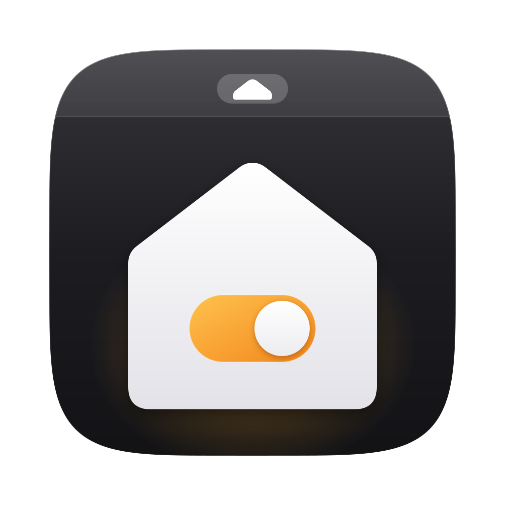
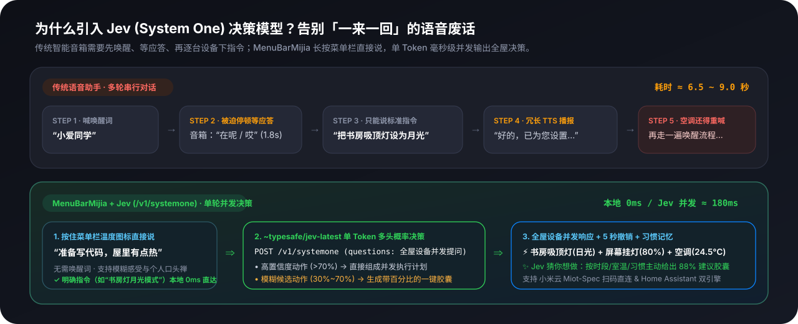
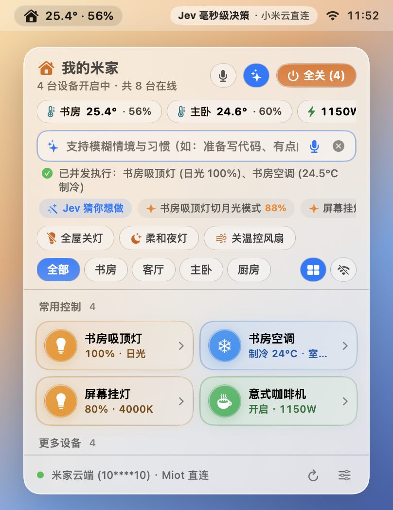

[English](README.md) | 简体中文

<p align="center">
  <picture>
    <source media="(prefers-color-scheme: dark)" srcset="docs/assets/logo-dark.svg">
    <source media="(prefers-color-scheme: light)" srcset="docs/assets/logo-light.svg">
    
  </picture>
</p>

<h1 align="center">MenuBarMijia</h1>

<p align="center">
  Mac 菜单栏里的米家语音助手（非官方，与小米公司无关）<br>
  <b>按住菜单栏说句话，松手即执行全屋多设备。不碰手机，也不跟音箱一来一回废话。</b>
</p>

> [!NOTE]
> 本项目是个人开源作品，与小米、米家、美的无关，也未获得其授权或认可。「小米」「米家」「美的」等是各自权利人的商标，本文仅用于说明兼容对象。

<p align="center">
  
  
  
  
  
</p>

<p align="center">
  
</p>

写代码写到一半，觉得屋里有点热、灯光有点刺眼。

以前你只有两个选择：
- **掏手机**：解锁 → 打开米家 → 等加载 → 找房间 → 调吸顶灯 → 退出去再找空调。六步走完，刚才代码的思路彻底断了。
- **喊小爱同学**：「小爱同学！」→ 等音箱叮一声回应「哎」→ 说「把书房灯调成月光模式」→ 等它听懂再播报一句「好的，已为您切换」→ 再喊一次「小爱同学！」去调空调。一来一回七八秒，费口舌又打断注意力。

**MenuBarMijia** 把这件事缩成一个动作：**鼠标按住屏幕顶部的菜单栏温度图标直接说话，松手即执行**；或者按 `⌥M` 呼出面板，敲一下键盘。

没有唤醒词，没有一来一回的语音播报，一句话同时操控多台设备，执行后可在撤销横幅内一键撤销。而且现在**无需购买 NAS、无需部署 Docker 或 Home Assistant**，下载后直接掏出手机米家 App 扫个码就能用。

---

## 为什么引入 Jev 决策模型：省掉所有口舌

传统的语音助手和大语言模型（LLM）都在「生成对话文本」——哪怕只是关个灯，模型也要一个词一个词地吐出 JSON 或回复话术，不仅慢，还经常把「切换月光模式」曲解成「单纯把亮度调暗」。

本项目接入了专为结构化快速决策设计的 **Jev 模型（`~typesafe/jev-latest`，基于 `/v1/systemone` 协议）**，配合本地确定性规则引擎，构成了**双层混合决策架构**：

<p align="center">
  
</p>

1. **明确指令本地解析（`LocalIntentParser`）**  
   像「打开书房灯」「书房吸顶灯月光模式」「空调 24 度」这类确定性指令，直接在本地离线匹配 Miot / HA 动作目录，**不需要等待网络推理**，且精准命中灯具原生的 `Night`（月光）/ `Day`（日光）情景模式。本地解析只负责生成控制指令；指令仍要经所选后端（小米云或 HA）到达设备，实际响应时间取决于网络与设备。
2. **复杂情境全屋并发决策（`Jev /v1/systemone`）**  
   当你说出模糊情境或跨设备组合指令（例如：「**我准备写代码了，屋里稍微有点热**」），Jev 的 `/v1/systemone` 接口会在一次请求中通过 `parallel_decisions` 并发输出全屋设备的动作概率分布——同时打开书房吸顶灯、开启屏幕挂灯、把书房空调设为 24.5°C 制冷。  
   **只有把握 ≥ 80% 的动作才会直接执行**；没把握的变成候选胶囊，点一下才执行。电暖器、插座、扫地机这类设备即使 AI 很有把握，也要你点一下确认（关电暖器除外）。

<p align="center">
  
</p>

### Jev 带来的三项个性化能力

- **🎯 模糊意图「概率追问胶囊」**：当你只说一句「稍微有点刺眼」或「有点冷」，Jev 不会自作主张乱关设备，而是直接根据单 Token 概率分布渲染出带置信度的候选胶囊（如 `✨ 书房吸顶灯切月光模式 91%`、`✨ 屏幕挂灯调至 20% 76%`），点一下立即执行。
- **✨「Jev 猜你想做」主动环境感知**：点击面板顶部的蓝色星光按钮（或栏内的 `Jev 猜你想做`），Jev 会结合**当前时段（早/中/晚/深夜）+ 各房间温湿度计实测数据 + 当前开启的设备**，推演出你此刻最可能需要的 3 个操作。
- **🧠 本地分时段习惯与口头禅记忆（`UserHabitMemory`）**：App 在本地自动学习你在清晨、下午、夜晚、深夜的高频操作组合，并记住你的个人口头禅（例如你常说的「准备写代码」「准备睡觉」对应哪几台设备的什么状态），每次请求自动注入 `<user_habits>` 上下文，越用越合手。
- **🔑 一键导入已有的 Key**：本机 CodexBar 或环境变量里已经配过 OpenRouter 等服务的 Key，在设置里点「从 CodexBar / 环境变量导入 Key」即可复制一份到本机钥匙串（不点就不会读取）；也支持自定义任意兼容接口。第一次要把指令发给云端模型时，App 会先问你一次，并说明会发送哪些内容。

---

## 按住菜单栏，直接开口说

不用先点开窗口、再去寻找麦克风按钮。我们在菜单栏图标上内置了双模式语音交互：

| 操作方式 | 触发逻辑 | 适合场景 |
| --- | --- | --- |
| **按住说话（Push-to-Talk）** | 鼠标左键**按住**菜单栏的 `🏠 25.4°` 图标不放（约 0.2 秒后触发），面板自动弹出并开始实时听写；说完**松开鼠标**立即发送执行 | 一句话快速下达指令，像对讲机一样干脆利落 |
| **短按免提听写** | 短按菜单栏图标即松手，或按快捷键 `V` / 点面板顶部 `🎙️`，进入免提监听，**说完停顿 1.1 秒自动提交** | 手头正在忙，不想一直按着鼠标 |
| **右键一键语音** | **右键点击**菜单栏图标 | 直接弹出面板并开启语音听写 |

---

## 免装 Home Assistant：手机米家扫码，开箱即用

以前想在 Mac 菜单栏控制米家，往往得先买一台 NAS 或树莓派，折腾 Docker、部署 Home Assistant、安装插件、申请长期令牌。

现在，我们把小米云端的通信协议直接用纯 Swift 内置进了 `MijiaCore`（**零第三方依赖**），提供**双后端自由切换**：

<p align="center">
  
</p>

### 模式一：米家云端直连（推荐新用户，0 门槛）
- **手机扫码即用**：打开设置切换到「米家云端直连」，用手机「米家」App 扫一下屏幕上的二维码即可完成绑定。
- **Miot-Spec 协议与 RC4 传输层加密**：内置 `MiCloudClient` 与 `MiotSynthesizer`，自动拉取你米家账号下的家庭、房间与设备列表，动态解析 `miot-spec-v2` 规格书（含吸顶灯 `mode` 日光/月光枚举、空调温控、插座功率、温湿度计、扫地机、冰箱等）。这里的 RC4 是小米云 `api.io.mi.com` 私有接口的传输层加密与签名（`MIOT-ENCRYPT-ALGORITHM: ENCRYPT-RC4`），不是端到端加密：指令和状态会经过小米服务器，小米能看到明文内容。RC4 本身也已是淘汰的弱算法，只用于兼容这个接口。
- **凭证存放**：登录凭证（`serviceToken` / `ssecurity`）写入 macOS 系统钥匙串（Keychain），不再新写明文配置；米家账号级的长期 `passToken` 不再保存。旧版本曾把凭证镜像到 `UserDefaults` 明文键，启动时会迁入钥匙串，**只有钥匙串写入成功后才会删除明文副本**；若钥匙串写入失败，明文会保留到下次启动重试。
- **通信范围**：米家登录与设备请求发往 `account.xiaomi.com` / `*.api.io.mi.com`，设备规格来自 `miot-spec.org`，检查更新访问 GitHub Releases；此外只会联系你自行配置的 HA 地址和 AI 接口。
- **账号风控提示**：`api.io.mi.com` 属于逆向的非公开客户端接口，小米历史上曾限制或要求重新登录使用非官方客户端的账号。若介意账号风控，请改用下方基于小米官方开源集成的 Home Assistant 模式。

### 模式二：Home Assistant 局域网实时连接（适合已有 HA / 跨生态玩家）
- **WebSocket 状态推送**：通过局域网 WebSocket 订阅 `state_changed`，支持小米官方 [`xiaomi_home`](https://github.com/XiaoMi/ha_xiaomi_home) 与美的 [`midea_ac_lan`](https://github.com/wuwentao/midea_ac_lan) 集成，把米家和美的设备放进同一个面板。
- **多实体智能收拢（`DeviceSynthesizer`）**：把 HA 里拆散的开关、功率、今日电量、童锁、网关指示灯等几十条实体，自动去噪并收拢成干净的「一台物理设备一张卡」。

<p align="center">
  
</p>

---

## 手不离开键盘

<p align="center">
  
</p>

按 `⌥M` 呼出面板，再按一次收起。打开之后，全程不碰鼠标也能操控全屋：

| 按键 | 作用 |
| --- | --- |
| `⌥M` | 全局呼出 / 收起 MenuBarMijia 面板 |
| `V` | 直接开启 / 停止实时语音控制（说完停顿 1.1s 自动执行） |
| `/` | 呼出自然语言指令栏并聚焦输入框 |
| `1` – `9` | 直接开关列表里的第 1 – 9 台设备（按住 `⌥` 浮现数字角标） |
| `↑` `↓` | 在设备之间移动焦点 |
| `Space` / `Return` | 开关当前设备；不能直接开关的，展开详情抽屉 |
| `→` `←` | 展开详情，再步进调节亮度 ±10%、温度 ±1°C、音量 ±10% |
| `Tab` | 在「全部」和各个房间之间切换 |
| `Esc` | 收起语音/指令栏、收起详情抽屉，或关闭面板 |

---

## 每类设备，都有趁手的专属控件

点开卡片右侧箭头，展开该品类专属的 Liquid Glass 控制抽屉：

| 设备 | 抽屉里能做什么 |
| --- | --- |
| **灯光** | 亮度 1–100% 液态滑块、色温 2700–6500K 光谱滑块、**日光 / 月光 (`Night`) / 阅读 / 电脑** 等原生情景模式一键切换 |
| **空调 · 电暖器** | 目标温度 0.5°C 步进、对照当前室温、制冷 / 制热 / 除湿 / 送风模式、风速档位与摆风开关 |
| **风扇** | 开关、风速百分比、自然风 / 直吹风预设模式、摇头控制 |
| **插座** | 实时功率（W）、今日用电量（kWh）、物理按键童锁开关 |
| **冰箱** | 冷藏室与冷冻室实测温度、目标温度调节，智能 / 速冷 / 速冻 / 假日模式切换 |
| **扫地机** | 清扫状态与电量显示，开始清扫 / 暂停 / 立即回充 |
| **小爱音箱** | 音量滑块、静音、放歌、停闹钟；直接打字让小爱 TTS 播报或静默执行指令 |
| **电视** | 唤醒开机、音量调节、输入信源切换 |

### 睡前一键全关 + 撤销横幅

面板右上角的「**全关**」**按住 0.6 秒**，关掉当前看到的（当前房间、未隐藏的）正在运行的灯、空调、电暖器和风扇。插座（常接路由器、冰箱、鱼缸）和扫地机默认不参与，可在设备右键菜单里选「参与「全关」」（Windows 1.1.0 在设置里勾选）。下方快捷栏提供「**全屋关灯**」「**柔和夜灯**」「**关温控风扇**」。

无论是手动点错，还是语音 / Jev 并发执行了多台设备，面板底部都会浮起一条撤销横幅：**1–2 台设备显示 10 秒，3 台及以上显示 15 秒**（指针停在横幅上会暂停倒计时）。点一下「**撤销**」，被改动的设备会按执行前的值逐条恢复（含原亮度、色温、灯效与空调温度）。横幅消失后，助手的最后一次动作仍会保留「**撤销上一步**」入口，10 分钟内有效。

### 多家庭切换、Mesh 分键识别、9 套主题皮肤与自定义分组布局

- **多家庭一键切换 & 多键 Mesh 面板自动拆键**：账号下有多个米家家庭时，直接点击面板顶部的家庭名称即可切换家庭（或查看全部家庭）；凌动/情景多键 Mesh 墙壁开关（如 `xxx.s2`、`xxx.s3` 分键设备）自动拆分为独立开关卡片，并对不支持情景模式的灯组自动隐藏无效情景按钮。
- **9 套视觉皮肤 & 面板高度调节**：在设置中可随时切换 **经典（Classic）**、**霜白（Frost）**、**夜航（Night Flight）**、**液态玻璃（Liquid Glass）**、**柔雾（Soft Mist）**、**便当格（Bento）**、**霓虹夜（Neon）**、**胶囊（Capsule）** 与 **晨光（Dawn）** 共 9 套主题，并支持紧凑 / 标准 / 加高 / 最大四档面板高度。
- **长按拖拽排版 & 自定义折叠分组**：长按任意设备卡片（或右键菜单选择「调整布局」）即可进入编辑模式，自由拖拽调整卡片顺序、跨区移入「常用控制」或自定义分组，并可按房间独立切换卡片尺寸（半宽 `1/2`、整行 `1x`、大面板 `Panel` 直出空调温控模块）。

---

## 菜单栏常驻与主动安全守护

<p align="center">
  
</p>

- **菜单栏一眼掌握室温与功耗**：支持在菜单栏常驻显示任意房间的温度、温湿度同显、全屋插座实时总功率、开启中的设备数，或仅保留简洁小房子图标。
- **主动安全与低电量提醒**：
  - 插座**上报实时功率且超过 300 W**、连续开启超过 45 分钟时提醒；没有功率数据的插座不会触发。空调、电暖器连续运行超过 4 小时也会提醒。通知上可直接点「**立即关闭**」
  - 温湿度计、门锁电量低于 15% 自动提醒（同一设备 24 小时内不重复；冷却时间持久化，重启应用不会重置）
  - 星标的常用设备突然掉线断电提醒

---

## 常用说法

打开指令栏（`⌥M` 或按住菜单栏图标）直接说。下面这些中英文口令不用联网，本地即可解析：

| 想做的事 | 中文说法 | 英文说法 |
| --- | --- | --- |
| 开关 | 「关客厅灯」「把空调打开」 | `"turn on study light"`, `"turn off all lights"` |
| 灯效模式 | 「书房吸顶灯月光模式」 | `"study light moonlight mode"`, `"daylight mode"` |
| 微调亮度 | 「再暗一点」「主卧灯亮一点」 | `"dimmer"`, `"brighter"`, `"study light 40%"` |
| 微调温度 | 「调高两度」「温度低一点」 | `"set living room ac to 24 degrees"`, `"warmer"` |
| 风扇 | 「风扇开高档」「风速调低」「摇头」「停止摇头」 | `"fan high speed"`, `"stop swing"` |
| 定时 | 「10 分钟后关灯」「半小时后关空调」；「取消定时」 | `"in 10 minutes turn off study light"`, `"cancel timer"` |
| 撤销 | 「撤销」「刚才那个撤销」（10 分钟内有效） | `"undo"`, `"revert"`（10 分钟内有效） |

> [!NOTE]
> 没说具体设备的微调（比如「再暗一点」）只作用于**正开着**的设备。定时任务会持久化到本地 `UserDefaults`：重启后未到期的定时自动继续倒计时；关闭应用期间已过期、或电脑睡眠时到点（晚了 1 分钟以上）的定时不会静默执行，会弹出系统通知并在指令栏提示「已错过」，由你选择立即补执行或忽略。

---

## 隐私

- **默认留在本机**：习惯记忆、口头禅与待执行定时保存在你 Mac 本机的 `UserDefaults` 明文配置中（`~/Library/Preferences/`，键名 `assistant_user_habit_memory_v1` 与 `assistant_scheduled_commands_v1`）；米家登录信息、HA 长期访问令牌、AI API 密钥和 LG 电视配对密钥保存在系统钥匙串（Keychain）里，米家会话也不再保存账号级的长期 `passToken`。从旧版本升级时，首次启动会把旧的明文凭证迁入钥匙串，**只有钥匙串写入成功才删除原键**；写入失败时明文副本会保留到下次启动重试，不会出现「凭证明失、需要重新登录」（旧会话数据本身已无法解码的情况除外，那种只能重新扫码登录）。1.1.0 发行包使用固定自签名证书，从旧版 ad-hoc 包升级时系统仍可能询问一次钥匙串访问权限；如果拒绝授权，需要重新扫码登录（或重新配对电视）一次。Windows 1.1.0 把米家会话、HA 令牌和 AI Key 放在 Windows 凭据管理器（Credential Manager），WebView 的 `localStorage` 只保留界面设置；升级时先重写不含凭证的设置副本，再尝试写入凭据管理器——因此即使凭据管理器拒绝写入，明文也不会留在 `localStorage`，但该次登录状态只存在于内存中，重启后需要重新登录。旧 Windows 包（至 v1.0.5）仍把凭据存在 WebView 的 `localStorage` 里。1.1.0 同时启用严格 CSP，并将原生请求限制为小米云、你配置的 AI 接口和 HA 地址。独立账号的凭据升级流程仍需实机验收。
- **发给 AI 的内容**：只有本地听不懂的话才会发给你配置的模型接口，请求体包含这句话、设备名称/房间/状态、时间段、环境摘要，以及（如果开着）习惯摘要。API Key 不会写进提示词，但会作为 HTTP `Authorization: Bearer` 头发给你配置的那个服务（本地 Ollama 等自建接口则发给它本身）；米家登录信息与 HA 令牌不会出现在这条请求里。设置页会说明会发送哪些内容。
- **可以关**：设置里能关掉「学习我的使用习惯」（关掉后不再记录，也不会发给 AI），也能逐条删除已记住的习惯。
- **LG 电视连接会固定证书**：首次连接 webOS 电视时，把该次 TLS 叶证书的 SHA-256 按电视 host 存进钥匙串。之后证书一旦变化，客户端直接拒绝连接、停止重试并弹出提示，不会默默信任新的身份。设置里的「重新信任电视」需要二次确认，确认后清除已保存的证书与配对密钥，并要在电视上重新确认配对。已保存的指纹读不出来时，同样按失败处理（失败即关闭）。
- **演示模式完全离线**：选中演示后端时，检查更新与下载更新、测试 AI 连接、AI 主动建议都会直接在本地返回结果或提示「请先切换数据源」，不会发出请求；局域网 HA 扫描与 LAN 电视连接同样遵循这条规则。切回演示模式会停止正在运行的电视连接、取消更新任务并清理已暂存的安装包。
- **语音可以只在本机识别**：打开「语音只在本机识别」后，声音不会发给苹果（需要系统支持该语言的离线识别）。

---

## 快速开始

**运行环境**：macOS 14（Sonoma）及以上（macOS 26 启用原生 SwiftUI `.glassEffect` 液态玻璃材质，macOS 14 与 15 自动回退到系统 `.ultraThinMaterial` 毛玻璃；核心库 `MijiaCore` 可直接作为 SwiftPM 包引用并在 Linux Swift 6.1 上编译）。

### 1. 下载安装（或从源码编译）

- **直接安装 DMG**：前往 [GitHub Releases](https://github.com/jryang1997/MenuBarMijia/releases/latest) 下载最新的 macOS 包（1.1.0 为 `MenuBarMijia-1.1.0.dmg`，适用 Apple Silicon），将 `MenuBarMijia.app` 拖入 `/Applications`（应用程序）。由于个人开源项目未购买付费 Apple 开发者公证，首次打开可能被 Gatekeeper 拦截。**推荐做法**：在「系统设置 → 隐私与安全性」底部对这条拦截点「仍要打开」，这样只放行这一个 App，系统其余检查保持有效。也可以在终端运行 `xattr -cr /Applications/MenuBarMijia.app` 放行，但这会清除该 App 的所有扩展属性、跳过隔离检查，请只在确认文件来源（本仓库 Releases 页面）时使用；签名公证上线后这条命令会被删除。
- **从源码编译并启动**：
  ```bash
  git clone https://github.com/jryang1997/MenuBarMijia.git
  cd MenuBarMijia
  bash scripts/build_app.sh       # 编译 Release，签名打包并启动「MenuBarMijia.app」
  ```

> [!TIP]
> `scripts/build_app.sh` 会自动生成包含麦克风与语音识别权限声明的 `MenuBarMijia.app` 并完成本地签名。你可以直接将生成的 `MenuBarMijia.app` 拖入 `/Applications`（应用程序）文件夹，并在设置中开启「登录 Mac 时自动启动」。

### 2. 连接你的米家设备（二选一）

#### 方式 A：米家云端扫码直连（推荐，无需任何额外硬件）
1. 点击菜单栏里的小房子图标 → 点击右下角设置按钮 `⚙️`
2. 在「连接配置」中选择 **「米家云端直连」**
3. 点击 **「扫码登录米家账号」**，用手机「米家」App 扫描二维码确认
4. 登录成功后，家庭房间与全屋设备会自动同步进面板，立即可控！

#### 方式 B：macOS 连接局域网 Home Assistant（可选）
1. 在「连接配置」中选择 **「Home Assistant」**，填入 HA 地址（如 `http://192.168.1.100:8123`）和长期访问令牌
2. 如果你有群晖 NAS 但还没装 HA，可使用仓库自带的一键部署脚本：`bash nas/deploy_ha.sh`（自动拉取镜像并预装 `xiaomi_home` 与 `midea_ac_lan`）

首次连接需要填写你自己的 HA 地址和长期访问令牌。令牌在 HA 的用户个人资料页面创建。连接后，客户端自动读取设备、实体、区域与状态，将已支持的设备类型合成到面板，无需逐台添加。默认地址为 `http://homeassistant.local:8123`；如果无法解析该主机名，填写 HA 的局域网 IP 地址。如果地址是 `http://` 且不是本机回环地址，访问令牌会以明文经过网络，设置页与新手引导会显示橙色提示并建议改用 HTTPS 或 Nabu Casa 地址。

---

## 参与开发与架构说明

纯 Swift Package，**零第三方 Swift 依赖**，开启 Swift 6 严格并发检查（Strict Concurrency）。核心协议、Miot-Spec 合成器、Jev `/v1/systemone` 决策客户端与习惯记忆引擎均位于独立的 `MijiaCore` 库中（支持 macOS 14+ 与 Linux），既可作为 SwiftPM 库单独引用，也可脱离 UI 运行单元测试。Windows 版是独立的第二套实现，一致性由 `Tests/Fixtures/` 下五份共享语料（`intent_golden.json`、`miot_golden.json`、`provider_golden.json`、`region_golden.json`、`ai_request_golden.json`）在两端的测试中分别断言，见 [`docs/adr/0006-dual-platform-implementation.md`](docs/adr/0006-dual-platform-implementation.md)。

```bash
bash scripts/check.sh           # 隐私/密钥扫描 + 编码规范检查 + swift test
bash scripts/linux-check/run.sh # 没有 Mac 时：在 Linux 上编译并测试 MijiaCore（需要 Swift 6.1）
```

### Windows 11 系统托盘版（`windows/`）

仓库内置基于 **Tauri v2 (Rust + TypeScript + WebView2)** 的 Windows 11 系统托盘客户端。它不是 macOS 的移植，而是**独立的第二套实现**：小米云协议、设备合成、本地解析与 AI 请求结构各写一遍，靠 ADR-0006 约定的共享测试语料（`Tests/Fixtures/` 下的 `intent_golden.json`、`miot_golden.json`、`provider_golden.json`、`region_golden.json`、`ai_request_golden.json`）在两端的测试里分别断言同一份行为。两端能力并不等同，以本节列出的为准。

从 1.1.0 起，Windows 版支持米家云扫码直连（含登录地区选择）和演示模式，**不连接 Home Assistant**。没有菜单栏按住说话，也没有主动安全提醒；语音用 WebView 的 `SpeechRecognition`，全局热键是 `Alt+M`。

Windows 的设备控制在云端确认成功后更新卡片，失败时显示错误；批量操作会报告部分失败，撤销只恢复成功指令修改过的属性，并保留原始开关状态。撤销失败可以重试；缺少原始属性值或操作无法逆转时，不提供撤销按钮。

展开灯具详情可切换设备支持的日光、月光等模式；不支持模式切换的灯具不显示模式按钮。

Windows 1.1.0 包含登录地区选择（#37）、更新检查（#39）、凭据管理器与严格 CSP（#28），以及插座与扫地机默认不参与的新版「全关」（#23）。地区列表有共享测试，海外真实账号尚未验收。Windows 安装包只有在发布工作流配置了签名证书时才做 Authenticode 签名；本次 1.1.0 为未签名包，首次运行可能遇到 SmartScreen 提示。

原生打包需安装 Visual Studio 的「使用 C++ 的桌面开发」组件和 Windows SDK，并使用 MSVC Rust 工具链。在 x64 Native Tools 命令行中构建；若已有 `CC` 或 `CXX` 环境变量指向其他编译器，在该命令行内设为 `cl.exe`。

```bash
cd windows
npm install
npm test        # 运行协议、意图解析和页面控制/撤销回归测试
npm run build   # TypeScript 严格类型检查 + 前端打包
npx tauri build # 在 Windows 上打包 .exe (NSIS) 与 .msi 安装包
```

每次推送到 `main` 分支时，GitHub Actions 会在核心测试通过后编译 Windows 安装包，并保存为 `MenuBarMijia-Windows-x64` 构建产物；普通推送不会发布任何东西。打 `v*` 标签只会生成**草稿**（6 个构建附件），由维护者离线签名后手动触发 `finalize.yml` 才正式发布；1.1.0 正式发布时要求七个附件：macOS DMG、其 SHA-256 与 Ed25519 签名，以及 Windows EXE/MSI 和各自的 SHA-256。旧版 v1.0.6 只有 macOS 附件，旧 Windows 包仍可从 v1.0.5 下载。

### 发布 macOS 安装版

```bash
DEVELOPER_ID="Developer ID Application: 你的名字 (TEAMID)" \
bash scripts/release.sh         # 签名 → 打 DMG → 苹果公证 → 盖章，产物在 dist/
```

版本号写在 `VERSION` 文件里，构建号自动取 git 提交数。需要苹果开发者账号；公证凭据先用 `xcrun notarytool store-credentials menubarmijia-notary` 存好（脚本开头有完整步骤）。只想本地打包、不公证：加 `SKIP_NOTARIZE=1`。发布包经草稿与 Finalize 正式发布后，用户在设置页点「检查更新」就能看到。

应用内更新还要求 DMG 带 Ed25519 分离签名；发布因此拆成两阶段，私钥始终不进 CI。

**阶段一：打标签构建（CI）。** 推送 `v*` 标签（或手动运行 `.github/workflows/release.yml` 并填入 `tag`）会依次执行 `verify-tag` → `macos-release` / `windows-release` → `stage-draft`。两个构建 job 只上传 artifact；`stage-draft` 创建或刷新一个**未发布草稿**，其中恰好 6 个构建附件（DMG、`.dmg.sha256`、EXE、`.exe.sha256`、MSI、`.msi.sha256`），结束时提示「⏳ 等待离线签名」。`release.yml` 里没有 `--draft=false`，推标签不会直接发布。

**阶段二：离线签名（维护者本机）。** 下载草稿里的 DMG，用离线私钥签名，只上传公有签名：

```bash
gh release download <tag> --pattern "MenuBarMijia-<版本>.dmg" --dir dist
MENUBARMIJIA_UPDATE_SIGNING_KEY="<32 字节 seed 的 base64 或 PKCS#8 PEM>" \
  swift scripts/sign_update.swift dist/MenuBarMijia-<版本>.dmg
gh release upload <tag> "dist/MenuBarMijia-<版本>.dmg.ed25519.sig"
```

**阶段三：Finalize（CI，手动触发）。** 手动运行 `.github/workflows/finalize.yml`（`workflow_dispatch`，唯一输入 `tag`）。它要求 tag 等于 `v$(VERSION)`、四处版本号一致、远程 tag 仍指向检出提交、目标必须是未发布草稿；然后下载**恰好 7 个**附件，逐个比对下载字节与草稿的服务端 `sha256:` digest 和大小，并用编译进 `UpdateChecker.updateSigningPublicKeyBase64` 的公钥验证 DMG 签名（没有可配置公钥，换密钥必须改源码并发新版）。全部通过后才执行 `gh release edit --draft=false`，**不重编译、不上传、不 `--clobber`**。缺少 `.sig` 时会打印离线命令并以非零退出；DMG 重建后仍挂旧签名同样硬失败，因此不会出现「没验签就发出去」的发布。

`release.yml` 与 `finalize.yml` 都不读取 `MENUBARMIJIA_UPDATE_SIGNING_KEY`：**CI 不持有 Ed25519 更新私钥**，只持有代码签名凭据（macOS 的 `MACOS_SIGNING_P12`、Windows 的 `WINDOWS_CERTIFICATE`）。

缺少 Ed25519 签名文件或签名不匹配时应用会拒绝安装。随后应用用 `identifier "<Bundle ID>" and certificate leaf = H"<钉住的 SHA-1>"` 校验解包后的 App：证书叶哈希本身就是锚点，`Info.plist` 里的 `MijiaCodeSignCertSHA1` 必须存在且为 40 位十六进制；**pin 缺失或格式非法时要求会变成 `identifier "<Bundle ID>" and never`**，所有更新都校验失败（包括同 Bundle ID 的包），不会退回「只认 Bundle ID」。

本机 ad-hoc 构建（`scripts/build_app.sh`）仍可正常运行，但没有有效 pin，因此**不能做应用内自动更新**。发布包必须用固定证书签名并写入该证书的 SHA-1：`scripts/release.sh` 在没有非 ad-hoc 签名身份或 pin 不匹配时会直接拒绝出包。细节见 [`docs/adr/0005-update-signing-trust-chain.md`](docs/adr/0005-update-signing-trust-chain.md)。

提交前请先阅读 [`CODING_STANDARDS.md`](CODING_STANDARDS.md)。领域术语见 [`GLOSSARY.md`](GLOSSARY.md)，架构决策记录在 [`docs/adr/`](docs/adr/)。

<details>
<summary>目录结构</summary>

```text
Sources/
├── MijiaCore/                          领域、协议与智能决策层（零 UI 依赖）
│   ├── Models.swift                    统一设备领域模型：SmartDevice / DeviceKind / DeviceCommand
│   ├── CommandIntent.swift             意图模型（开关、亮度、色温、相对微调、风扇档位、摇头……）与校验
│   ├── LocalIntentParser.swift         本地自然语言解析（中文 + 英文，不联网）
│   ├── ModelIntentResolver.swift       Jev /v1/systemone 概率决策客户端与错误提示
│   ├── AssistantConfig.swift           模型接口配置
│   ├── AssistantSchedule.swift         「10 分钟后…」「取消定时」「撤销」识别与定时持久化
│   ├── UserHabitMemory.swift           本地分时段习惯学习与个人口头禅记忆引擎
│   ├── UpdateChecker.swift             读取 GitHub Releases 检查新版本（含 Ed25519 更新签名校验）
│   ├── MiCloud/                        小米云直连后端（免 Home Assistant）
│   │   ├── MiAccountLogin.swift        小米账号二维码生成、长轮询登录与 Keychain 会话管理
│   │   ├── MiCloudClient.swift         小米 IoT 云端 RC4 传输层签名与 Miot-Spec RPC 客户端
│   │   ├── MiCloudCrypto.swift         RC4 加解密与 `ssecurity`/nonce 签名实现
│   │   ├── MiotSpec.swift              miot-spec-v2 规格书模型、拉取与磁盘缓存（`MiotSpecStore`）
│   │   ├── MiotSynthesizer.swift       Miot 属性到 SmartDevice 的自动合成与日光/月光灯效映射
│   │   └── MiCloudProvider.swift       小米云实时轮询与指令派发 Provider
│   ├── DeviceSynthesizer.swift         Home Assistant 多实体聚合、房间排序、噪音过滤
│   ├── HomeProvider.swift              HomeProvider 协议、HA WebSocket 实时流
│   ├── DemoHomeProvider.swift          演示模式的后端实现
│   ├── HomeStore.swift                 @Observable 状态中心：双后端切换、乐观锁、防抖、撤销横幅（1–2 台 10 秒 / 3 台以上 15 秒）
│   ├── HomeStore+Assistant.swift       指令执行：意图落地、定时恢复、过期确认、语音撤销（10 分钟窗口）
│   └── KeychainAndPrefs.swift          macOS 钥匙串安全存储与偏好设置
└── MenuBarMijiaApp/                    SwiftUI + AppKit 原生界面层
    ├── MenuBarMijiaApp.swift           应用入口与生命周期绑定
    ├── ControlCenterPanel.swift        主面板、环境胶囊、快捷场景栏、浮动撤销横幅
    ├── AssistantCommandBar.swift       自然语言指令栏、SFSpeech 实时语音听写、Jev 概率胶囊
    ├── MiAccountSection.swift          米家扫码登录与云端状态组件
    ├── DeviceCardView.swift            双列磁贴与各品类专属控制抽屉
    ├── Skins.swift                     9 套皮肤（经典/霜白/夜航/液态玻璃/柔雾/便当格/霓虹夜/胶囊/晨光）
    ├── HotkeyAndNotificationManager.swift  NSStatusItem 菜单栏长按说话、⌥M 热键与主动安全通知
    ├── SettingsWindowView.swift         双后端连接配置、Jev 决策设置与偏好面板
    ├── UndoAvailabilityTracker.swift    横幅消失后的「撤销上一步」入口（10 分钟）
    └── ThemeAndMotion.swift            macOS 26 Liquid Glass 与 macOS 14+ 毛玻璃自适应材质、阻尼弹簧动效
Tests/
├── Fixtures/                           双端共享测试语料：intent_golden.json、miot_golden.json、provider_golden.json、region_golden.json、ai_request_golden.json
└── MijiaCoreTests/                     Swift Testing 单元测试套件（覆盖合成、Miot、Jev、定时持久化、习惯记忆等）
scripts/                                打包（build_app.sh）、发布公证（release.sh）、门禁检查（check.sh）、Linux 测试（linux-check/）
nas/                                    群晖 NAS 一键部署 Home Assistant 脚本（可选）
docs/                                   ADR、规格文档与 README 实机截图/动图资源
```

</details>

## 第三方组件说明

本仓库不包含、也不分发以下第三方集成，NAS 部署脚本仅在你需要 Home Assistant 模式时从官方地址下载到你自己的设备上：

| 组件 | 来源 | 许可 |
| --- | --- | --- |
| Xiaomi Home Integration（`xiaomi_home`） | [XiaoMi/ha_xiaomi_home](https://github.com/XiaoMi/ha_xiaomi_home) | 小米自有许可，见 [LICENSE.md](https://github.com/XiaoMi/ha_xiaomi_home/blob/main/LICENSE.md) |
| Midea AC LAN（`midea_ac_lan`） | [wuwentao/midea_ac_lan](https://github.com/wuwentao/midea_ac_lan) | MIT，见 [LICENSE](https://github.com/wuwentao/midea_ac_lan/blob/master/LICENSE) |
| Home Assistant | [home-assistant/core](https://github.com/home-assistant/core) | Apache-2.0 |

本仓库的 MIT 许可覆盖本项目自身的全部源码。

## 贡献者与致谢

感谢为 MenuBarMijia 提交代码、修补协议细节与打磨交互体验的贡献者：

- [@jryang1997](https://github.com/jryang1997)（一群小羊说）— 项目发起与维护
- [@almightyYantao](https://github.com/almightyYantao)（Alimighty.Yantao）— 多键 Mesh 开关分键设备识别与合成（[#6](https://github.com/jryang1997/MenuBarMijia/issues/6)、[#7](https://github.com/jryang1997/MenuBarMijia/pull/7)）、米家多家庭切换与灯组情景过滤（[#8](https://github.com/jryang1997/MenuBarMijia/pull/8)）、多主题面板皮肤、空调/温湿度计独立模块、长按拖拽自由布局与自定义分组（[#9](https://github.com/jryang1997/MenuBarMijia/pull/9)）、macOS 应用图标打包集成（[#10](https://github.com/jryang1997/MenuBarMijia/pull/10)）、面板下落动画、本地设备重命名与房间栏细节打磨（[#11](https://github.com/jryang1997/MenuBarMijia/pull/11)）

## License

[MIT](LICENSE) © jryang1997 (一群小羊说)
